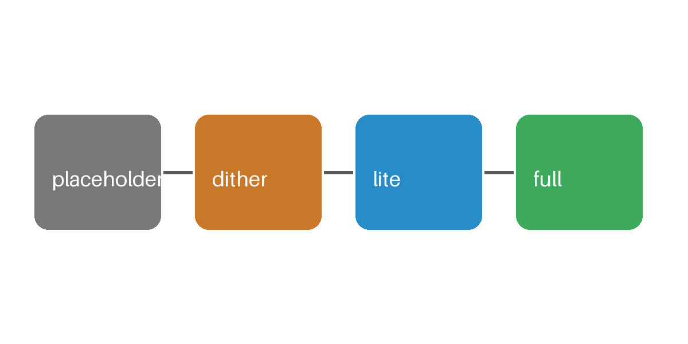

This blog is built by a small Python static site generator. Images load at a quality that suits your connection.

## How images load

Every image starts as a tiny dithered placeholder inlined in the page, so nothing moves while loading.



On a slow connection you get a dithered WebP; on a fast one, AVIF. Select any image to open it at full size.

### Code

```python
def hello():
    print("hello, world")
```

| Tier | Format |
|------|--------|
| dither | lossless WebP, 8 colours, ordered dither |
| lite | WebP q45 |
| full | AVIF / WebP / JPEG |
